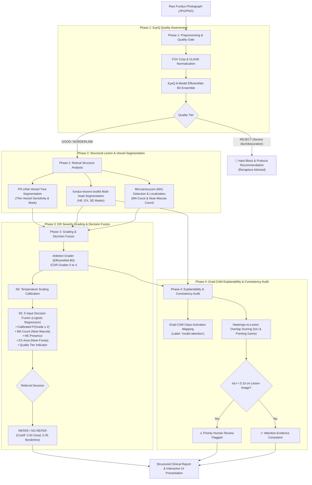

# NETRA-DR: Explainable AI Diabetic Retinopathy Screening Pipeline
## System Architecture, Technical Specification & Repository Analysis

---

## 1. Executive Summary & Clinical Mission

**NETRA-DR** (SIH-26038) is an end-to-end, clinically gated, explainable artificial intelligence screening system designed for automated Diabetic Retinopathy (DR) triage from digital retinal fundus photographs.

Unlike black-box classifiers that predict severity grades directly from raw images, NETRA-DR implements a **4-Phase Gated Diagnostic Architecture**:
1. **Phase 1 — Quality Gate**: Assesses photograph quality using an 8-model ensemble; strictly halts ungradable images to prevent false reassurance or erroneous referrals.
2. **Phase 2 — Retinal Structure Analysis**: Quantifies pathological lesions (Microaneurysms, Hemorrhages, Hard Exudates, Soft Exudates) and segments the retinal vessel tree.
3. **Phase 3 — DR Grading & Decision Fusion**: Combines deep learning disease grading with calibrated probabilities and quantified anatomical evidence into a unified referral recommendation.
4. **Phase 4 — Explainability & Consistency Audit**: Computes Class Activation Maps (Grad-CAM) representing **"model attention"** and mathematically audits their spatial overlap against Phase 2 **"detected evidence"** to flag inconsistent predictions for mandatory human ophthalmologist review.

---

## 2. End-to-End Pipeline Architecture



---

## 3. Detailed Phase-by-Phase Breakdown

### Phase 1: Intake Preprocessing & Quality Assessment Gate
* **Purpose**: Prevents garbage-in/garbage-out by filtering poor quality photographs before running heavy diagnostic models.
* **Models / Algorithms**:
  - **Preprocessing**: Circular Field of View (FOV) mask detection, black-border cropping, aspect-ratio preserved resizing to $512 \times 512$, and Contrast Limited Adaptive Histogram Equalization (CLAHE) on the green channel.
  - **Quality Engine**: EyeQ 8-checkpoint ensemble based on **EfficientNet-B4** trained on the EyeQ dataset across multiple random seeds.
* **Outputs**:
  - `quality_label`: `"Good"`, `"Borderline"`, or `"Reject"`.
  - `probabilities`: Softmax probabilities across Good, Borderline, and Reject.
  - `quality_score`: Confidence score $[0.0, 1.0]$.
* **Gate Logic**: If `quality_label == "Reject"`, downstream Phases 2, 3, and 4 are hard-blocked to avoid hallucinatory or unreliable inferences.

### Phase 2: Retinal Structure Analysis
* **Purpose**: Provides quantified, objective anatomical evidence extraction.
* **Models / Algorithms**:
  - **Vessel Segmentation**: **FR-UNet** (Full-Resolution UNet) running on the green channel. Calculates total vascular area and thin-vessel sensitivity proxy.
  - **Lesion Segmentation**: **fundus-lesions-toolkit** deep segmentation network producing distinct, non-merged binary masks for:
    - **Hemorrhages (HE)**: Quantifies total area fraction and per-quadrant distribution (TL, TR, BL, BR).
    - **Hard Exudates (EX)**: Quantifies overall area and proximity to foveal center.
    - **Soft Exudates / Cotton Wool Spots (SE)**: Quantifies presence and area.
  - **Microaneurysms (MA)**: Channel-specific candidate extractor reporting total count and near-macula count.
* **Outputs**: Independent labeled mask arrays and high-resolution visual overlays encoded as PNG data URIs.

### Phase 3: DR Severity Grading & Decision Fusion
* **Purpose**: Multi-class International Clinical Diabetic Retinopathy (ICDR 0–4) classification backed by transparent multi-modal decision fusion.
* **Models / Algorithms**:
  - **Grading Network**: **drdetect** (EfficientNet-B0 backbone) trained on APTOS/EyePACS predicting raw 5-class logits:
    - `0`: No Apparent Retinopathy
    - `1`: Mild NPDR
    - `2`: Moderate NPDR
    - `3`: Severe NPDR
    - `4`: Proliferative DR (PDR)
  - **Calibration (S6)**: Validation-fitted Temperature Scaling ($T$) to calibrate overconfident neural network softmax probabilities without shifting class rank.
  - **Decision Fusion (S5)**: A shallow, explainable Logistic Regression classifier that ingests exactly 5 features:
    1. Calibrated probability $P(\text{ICDR} \ge 2)$
    2. MA count (weighted by near-macula presence)
    3. Hemorrhage presence ($0/1$)
    4. Hard exudate area near fovea
    5. Quality tier indicator ($1$ for Borderline, $0$ for Good)
* **Tiered Thresholding**:
  - **Good Quality**: Referral threshold $= 0.50$.
  - **Borderline Quality**: Stricter referral threshold $= 0.35$ to compensate for reduced lesion contrast.

### Phase 4: Explainability & Attention-Evidence Consistency Audit
* **Purpose**: Explains why the grading network predicted a severity class and validates whether the network attended to real clinical features.
* **Models / Algorithms**:
  - **Grad-CAM**: Extracts gradients flowing into the final convolutional feature maps of the grader for the target predicted class, producing a 2D activation heatmap $[0.0, 1.0]$.
  - **Consistency Auditor**: Computes Intersection-over-Union (IoU) and Pointing Game metrics between the binarized Grad-CAM attention map and Phase 2 lesion masks (HE and EX).
* **Clinical Guardrail**:
  - Visual heatmaps are strictly labeled **`model attention`** (never "detected evidence").
  - Segmented lesion maps are strictly labeled **`detected evidence`** (never "model attention").
  - If a patient has significant lesion load ($>100$ px) but Grad-CAM attention has an $\text{IoU} < 0.10$ with those lesions, the system issues a **`Priority Human Review`** warning.

---

## 4. Complete Repository File Structure

```
NETRA-DR/
│
├── app/                                  # Web Application & Interactive UI Layer
│   ├── static/
│   │   └── style.css                     # Custom CSS design system (dark glassmorphism, responsive grid, badges)
│   ├── templates/
│   │   └── index.html                    # Single-page interactive diagnostic UI & AJAX lifecycle controller
│   ├── __init__.py
│   └── app.py                            # Flask server, session manager & REST API routing
│
├── configs/                              # Pipeline Parameter & Calibration Store
│   ├── calibration.json                  # Fitted temperature value (T) for probability calibration
│   ├── decision_rule.json                # Quality-tier threshold rules (Good: 0.50, Borderline: 0.35)
│   └── preprocessing.json                # Image resolution (512x512), CLAHE parameters, FOV crop bounds
│
├── data/                                 # Evaluation & Benchmark Datasets
│   └── demo/
│       ├── good_sample.jpg               # High-quality benchmark image (passes Quality Gate)
│       └── reject_sample.jpg             # Severe blur/artifact sample (triggers Quality Gate halt)
│
├── external/                             # External Deep Learning Packages & Model Hubs
│   └── EyeQ/                             # EyeQ Quality Assessment codebase
│       ├── checkpoints/                  # 8-model EfficientNet-B4 trained weights
│       └── src/                          # EyeQ model definition and dataset transforms
│
├── models/                               # Local Model Definitions & Contract Files
│   ├── vessel_seg/                       # FR-UNet configuration & model artifacts
│   ├── lesion_seg/                       # fundus-lesions-toolkit multi-class lesion segmentation
│   ├── ma_detector/                      # Microaneurysm detection configuration
│   ├── grading/                          # drdetect EfficientNet-B0 grading weights & metadata
│   ├── temperature_scaling/              # Temperature scaling configuration
│   └── decision_fusion/                  # Decision fusion logistic regression weights
│
├── pipeline/                             # Core Python 4-Phase Diagnostic Engine
│   ├── __init__.py
│   ├── contract.py                       # Model contract enforcement, shape & dtype validator
│   ├── preprocessing.py                  # FOV circular crop, CLAHE contrast adjustment, tensor conversion
│   ├── quality.py                        # High-level entry point for Phase 1 quality assessment
│   ├── quality_service.py                # Thread-safe in-process EyeQ model loader and ensemble evaluator
│   ├── structure.py                      # Phase 2 engine: FR-UNet vessel & lesion segmentation wrappers
│   ├── grading.py                        # Phase 3 engine: drdetect grader inference & temperature scaling
│   ├── decision.py                       # Phase 3 engine: 5-input decision fusion logic & thresholding
│   ├── explain.py                        # Phase 4 engine: Grad-CAM generation & colormap blend overlay
│   ├── orchestrator.py                   # Master orchestrator coordinating stages S1 through S10
│   ├── report.py                         # Clinical structured reporting engine (JSON/PDF generation)
│   └── startup_check.py                  # Pre-flight hardware, library, and checkpoint verification
│
├── tests/                                # Comprehensive Automated Pytest Suite
│   ├── fixtures/                         # Synthetic test images and mock tensors
│   ├── test_preprocessing.py             # Preprocessing & normalization tests
│   ├── test_quality.py                   # Quality gate thresholding & routing tests
│   ├── test_structure_vessel.py          # Vessel mask shape, non-degeneracy & sensitivity tests
│   ├── test_structure_lesion.py          # HE, EX, SE lesion segmentation tests
│   ├── test_structure_ma.py              # Microaneurysm detection & localization tests
│   ├── test_grading.py                   # 5-class ICDR probability vector & monotonicity tests
│   ├── test_calibration.py               # Temperature scaling & confidence calibration tests
│   ├── test_decision.py                  # Decision fusion & quality-tier cutoff tests
│   ├── test_explain.py                   # Grad-CAM heatmap generation & IoU consistency tests
│   ├── test_full_ui_pipeline.py          # End-to-end Flask API and state transition tests
│   └── test_report.py                    # Clinical report generator tests
│
├── requirements.txt                      # Python dependencies (PyTorch, Torchvision, OpenCV, Flask, etc.)
├── run_demo.bat                          # Windows one-click start script
├── run_demo.sh                           # Unix/macOS one-click start script
└── README.md                             # Project overview, installation, and deployment instructions
```

---

## 5. Detailed Responsibilities of Every File

### `app/` (Application Layer)
* **`app/app.py`**:
  - Initializes the Flask application.
  - Manages in-memory session persistence (`_SESSIONS`) indexed by `analysis_id` (UUID).
  - Routes:
    - `GET /`: Renders main upload portal with model readiness status.
    - `POST /`: Handles image upload / demo image selection, executes Phase 1 Quality Gate, and initializes session.
    - `POST /api/phase2`: Asynchronously executes Phase 2 Retinal Structure Analysis on the preprocessed image.
    - `POST /api/phase3`: Asynchronously executes Phase 3 DR Grading, Calibration, and Decision Fusion.
    - `POST /api/phase4`: Asynchronously executes Phase 4 Grad-CAM explainability and consistency audit.
    - `POST /api/run_all`: Executes all 4 phases end-to-end in a single batch call.
    - `GET /api/status`: System health and model readiness check.
* **`app/templates/index.html`**:
  - Interactive HTML5 user interface.
  - Provides drag-and-drop image upload, instant demo testing buttons (Good / Reject), and sequential stage activation.
  - Implements asynchronous JavaScript `fetch()` handlers (`runPhase2()`, `runPhase3()`, `runPhase4()`) that render dynamic metric cards, interactive probability distribution bars, and side-by-side evidence overlays without reloading the page.
* **`app/static/style.css`**:
  - Complete vanilla CSS design system adhering to clinical usability standards.
  - Implements high-contrast dark theme, color-coded diagnostic badges (`badge-good`, `badge-borderline`, `badge-reject`), responsive grids, spinning loaders, and mandatory distinction badges for *model attention* (purple) vs. *detected evidence* (green/amber).

---

### `pipeline/` (Core Algorithmic Engine)
* **`pipeline/orchestrator.py`**:
  - The master pipeline conductor implementing the 10 formal stages:
    - `S1`: Vessel segmentation (FR-UNet)
    - `S2`: Lesion detection (fundus-lesions-toolkit: HE/EX/SE/MA)
    - `S3`: Neovascularisation stub (explicitly labeled distinct from Grade 4)
    - `S4`: Primary DR grading (drdetect EfficientNet-B0)
    - `S5`: 5-input decision fusion (Logistic Regression)
    - `S6`: Temperature scaling calibration
    - `S7`: Multi-checkpoint ensemble inference
    - `S8`: Grad-CAM explainability
    - `S9`: Quality-tier threshold enforcement
    - `S10`: Attention-vs-evidence consistency audit
  - Provides `run_netra_pipeline(image, quality_tier, config)` for batch processing.
* **`pipeline/preprocessing.py`**:
  - Implements `preprocess(image)`: extracts the circular fundus region, eliminates non-retinal black borders, normalizes dimensions to $512 \times 512$, and applies CLAHE to enhance vascular and lesion contrast.
* **`pipeline/quality.py`**:
  - Entry point `run_quality_gate(image_path)` that coordinates preprocessing and invokes `QualityService` to categorize fundus quality into Good, Borderline, or Reject.
* **`pipeline/quality_service.py`**:
  - Singleton service managing in-memory loading and GPU/CPU inference for the 8-model EyeQ EfficientNet-B4 ensemble.
* **`pipeline/structure.py`**:
  - `run_vessel_segmentation()`: Executes FR-UNet to generate binary vessel trees and vessel overlays.
  - `run_lesion_segmentation()`: Executes multi-class lesion segmentation returning independent masks for Hemorrhages (HE), Hard Exudates (EX), and Soft Exudates (SE).
  - `run_ma_detection()`: Detects microaneurysm pinpoint lesions and returns spatial coordinates and count.
* **`pipeline/grading.py`**:
  - `run_grading()`: Runs the `drdetect` EfficientNet-B0 model to produce raw logits and softmax probabilities across ICDR Grades 0 to 4.
  - `apply_calibration()`: Applies temperature scaling $P_i = \frac{e^{z_i / T}}{\sum_j e^{z_j / T}}$ to yield calibrated probabilities.
* **`pipeline/decision.py`**:
  - `run_decision_fusion()`: Implements the 5-feature logistic regression decision rule, reporting both `referable_decision` (quality-aware) and `grade_alone_decision` (naive cutoff) side-by-side.
* **`pipeline/explain.py`**:
  - `run_gradcam()`: Computes Class Activation Maps for the predicted severity class and blends them with the fundus photograph using `cv2.applyColorMap`.
* **`pipeline/report.py`**:
  - `generate_clinical_report()`: Generates structured, timestamped clinical screening reports containing quality metrics, lesion quantification, severity grade, referral decision, and explainability audit logs.
* **`pipeline/startup_check.py`**:
  - System diagnostic tool verifying that checkpoints for EyeQ, FR-UNet, fundus-lesions-toolkit, and drdetect exist before runtime.
* **`pipeline/contract.py`**:
  - Schema definition and validator ensuring that all models conform to strict input tensor shape, normalization, and output format contracts.

---

### `configs/` (Configuration Layer)
* **`configs/preprocessing.json`**: Target image height/width ($512 \times 512$), CLAHE clip limit ($2.0$), grid size ($8 \times 8$).
* **`configs/decision_rule.json`**: Decision thresholds defining Good quality cutoff ($0.50$) and Borderline quality cutoff ($0.35$).
* **`configs/calibration.json`**: Fitted temperature parameters from validation split.

---

### `tests/` (Verification Suite)
* **`tests/test_quality.py`**: Validates EyeQ quality classification across Good, Borderline, and Reject images.
* **`tests/test_structure_vessel.py`**: Validates vessel mask shape, dtype, non-degeneracy, and thin-vessel sensitivity calculation.
* **`tests/test_structure_lesion.py`**: Verifies that HE, EX, and SE masks are generated as distinct outputs and never merged into a single scalar score.
* **`tests/test_structure_ma.py`**: Verifies microaneurysm candidate detection, bounding, and near-macula counting.
* **`tests/test_grading.py`**: Verifies 5-class output shape, probability summation ($\sum P = 1.0$), and ICDR class indexing.
* **`tests/test_calibration.py`**: Verifies temperature scaling smoothness and rank-preservation.
* **`tests/test_decision.py`**: Tests decision fusion under different quality tiers (verifying that Borderline tier triggers higher-sensitivity $0.35$ cutoff).
* **`tests/test_explain.py`**: Tests Grad-CAM heatmap generation, colormap overlay dimensions, and IoU overlap calculation against lesion masks.
* **`tests/test_full_ui_pipeline.py`**: End-to-end API integration tests simulating sequential browser calls from Phase 1 through Phase 4.

---

## 6. Clinical Rules, Safety Constraints & Guardrails

| Constraint | Architectural Rule | Enforcement Location |
| :--- | :--- | :--- |
| **Strict Quality Gating** | Reject-quality images are hard-blocked from automated diagnosis; recapture is advised. | `pipeline/quality.py` & `app/app.py:L461` |
| **Mandatory Label Separation** | Grad-CAM must be labeled **`model attention`**; segmented lesions must be labeled **`detected evidence`**. They must never be merged. | `pipeline/explain.py` & `app/templates/index.html` |
| **No Hallucinated Lesion Subtypes** | Hemorrhages are reported strictly by presence, area fraction, and quadrant count — no unverified clinical subtypes (flame / dot-blot / deep). | `pipeline/structure.py` & `pipeline/orchestrator.py` |
| **Neovascularisation Distinction** | Neovascularisation stub returns `None` with an explicit disclaimer that NV detection is separate from ICDR Grade 4. | `pipeline/orchestrator.py:L342-366` |
| **Quality-Tier Referral Cutoffs** | Good quality images use a $0.50$ cutoff; Borderline quality images use a stricter $0.35$ cutoff to protect sensitivity. | `pipeline/decision.py` & `configs/decision_rule.json` |
| **Attention-Evidence Auditing** | Discrepancies where the model predicts severe disease but focuses attention away from detected lesions trigger a Priority Human Review flag. | `pipeline/orchestrator.py:S10` & `app/templates/index.html` |

---

## 7. How to Run and Test

### 1. Launching the Interactive Web Interface
```bash
# Windows
run_demo.bat

# Or directly with Python
python app/app.py
```
Open your browser at `http://127.0.0.1:5000`.

### 2. Testing Execution Modes
* **Step-by-Step Interactive Mode**:
  1. Click **🟢 Good Sample** or upload a fundus JPG/PNG.
  2. Click **▶ Step 1: Assess Image Quality** $\rightarrow$ Phase 1 card renders.
  3. Click **▶ Run Phase 2 (Structure Analysis)** $\rightarrow$ Visualizes vessels, MA pinpoints, and HE/EX/SE overlays.
  4. Click **▶ Run Phase 3 (Grading & Fusion)** $\rightarrow$ Calibrated ICDR severity distribution and referral decision render.
  5. Click **▶ Run Phase 4 (Grad-CAM & Consistency)** $\rightarrow$ Compares *model attention* heatmap vs *detected evidence* with IoU consistency audit.
* **Batch End-to-End Mode**:
  - Click **⚡ Run Complete Pipeline (Phases 1–4)** to execute the full diagnostic chain in a single unified step.

### 3. Running the Automated Test Suite
```bash
pytest tests/ -v
```
All unit tests verify model contracts, tensor dimensions, probability bounds, and failure safety mechanisms.
